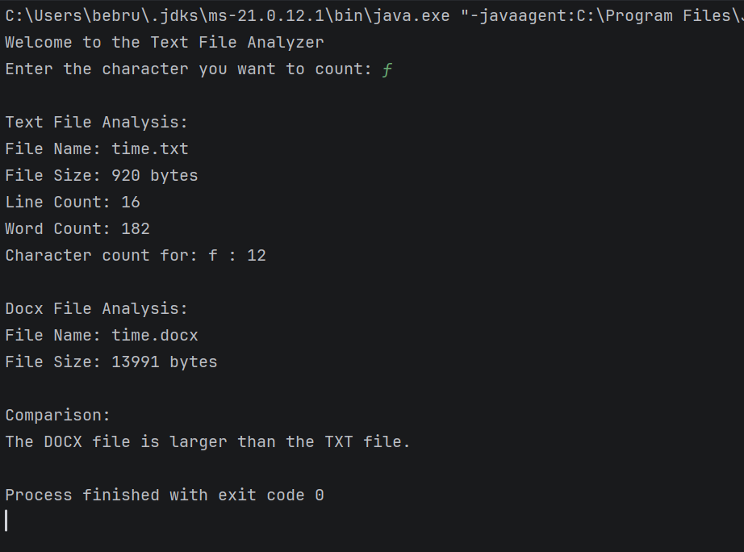

# Text File Analyzer

## Description
This Java program reads a text file and counts the number of lines, words, and occurrences of a character entered by the user. It also displays the file sizes of a TXT file and a DOCX file and compares their sizes.

## Files
- `TextFileAnalyzer.java` - Main Java program
- `time.txt` - Text file used for testing
- `time.docx` - Word document containing the same text
- `README.md` - Project documentation

## How to Run
1. Open the project in IntelliJ IDEA.
2. Make sure `time.txt` and `time.docx` are in the project directory.
3. Run `TextFileAnalyzer.java`.
4. Enter a character when prompted.
5. View the analysis and file size comparison in the console.

## Example Results
The program counted 16 lines, 182 words, and 12 occurrences of the letter `f` in `time.txt`.

The TXT file was 920 bytes, while the DOCX file was 13,991 bytes.

## Screenshot

